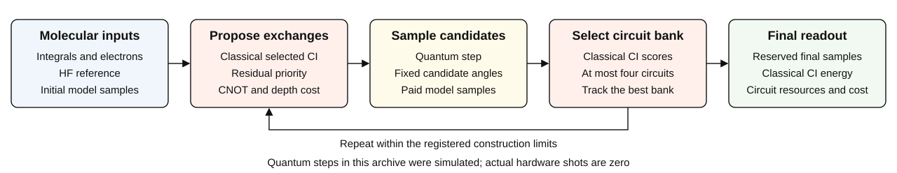

# RAACS

**Resource-aware adaptive configuration sampling for quantum chemistry.**

[](https://github.com/Reimangod/raacs-study/actions/workflows/test.yml)
[](LICENSE)
[](LICENSE-DATA.md)

RAACS builds a small bank of sampling circuits to collect electronic
configurations. Classical configuration interaction (CI) identifies useful
configurations and guides the next circuit operations. This repository contains
the method, recorded simulation results, LUCJ and SqDRIFT comparisons, and tools
to reproduce the saved tables and figures.



## Start here

| Task | Resource |
|---|---|
| Understand RAACS | [Method](docs/METHOD.md) |
| Find results for a molecule | [Results and figure guide](results/README.md) |
| Work with the numerical data | [Data guide](data/README.md) and [catalog](data/catalog.csv) |
| Reproduce tables and figures | [Reproduction instructions](docs/REPRODUCTION.md) |
| Interpret the comparisons | [Definitions](docs/DATA_DICTIONARY.md) and [limitations](docs/LIMITATIONS.md) |
| Inspect the algorithm implementations | [Reference source map](reference/README.md) |

## Quick start

Python 3.11 or newer and [uv](https://docs.astral.sh/uv/getting-started/installation/) are required.

```sh
uv sync --locked --extra test
uv run --no-sync raacs-study verify --repo .
uv run --no-sync raacs-study reproduce --repo . --output reproduced
uv run --no-sync pytest -q
```

The summary appears in `reproduced/endpoint-summary.csv` and the figures in
`reproduced/figures/`. No GPU, quantum hardware, or raw-archive download is needed.
These commands reuse saved data; they do not repeat molecular sampling.

## Dataset

| Molecule | Geometry | Qubits |
|---|---|---:|
| LiH | 1.5, 3.0 Å | 10 |
| BeH2 | 1.3, 2.5 Å | 12 |
| Linear H6 | 1.4, 2.2 Å | 12 |
| Naphthalene | Registered block-Boys setup | 20 |
| N2 | 1.2, 2.4 Å | 32 |
| Fe2S2 | Registered cluster geometry | 40 |

The catalog has **6,261 readout records across 10 physical conditions**.
Naphthalene has two acquisition cohorts, which remain separate. A readout row
at another Shot or CI setting is not an independent experiment. All recorded
results, including failed or dimension-unreached readouts, remain in the data.

## Reading the results

- **Energy** is evaluated after classical CI, not necessarily on a sampling circuit.
- **Recovery** is correlation-energy recovery, not recovery from noise.
- **Shots** are noiseless simulation samples; hardware shots are zero.
- **R** is the spin-string cap; **D** is the obtained determinant-space dimension.
- **CNOT and depth** describe sampling circuits under the registered decomposition.

Compare methods within the same physical problem, cohort, final shots, actual D,
and spin convention. Equal final shots and D do not equalize initialization,
construction measurements, or classical cost. Fixed-initialization LUCJ controls
are not a claim about the best fully optimized LUCJ. Reference-quality gaps and
missing controls are listed in [limitations](docs/LIMITATIONS.md).

## Layout

`data/` contains records and checksums; `configs/` contains the registered policy
and cohort settings; `reference/` contains the relevant original algorithm
sources; `src/` contains the lightweight reproduction tools; `results/` contains
the saved-data products. Tests run automatically in GitHub Actions.

## Citation and reuse

Use [CITATION.cff](CITATION.cff) and identify the exact code revision and dataset
version. [Method references](docs/REFERENCES.md) distinguish publications,
preprints, and implementation sources. The numerical results are from this
study, not copied literature tables. No publication DOI has been assigned.

New reproduction code is [MIT licensed](LICENSE); independently owned data is
[CC BY 4.0](LICENSE-DATA.md). [Third-party terms](THIRD_PARTY.md) remain separate.
The original full archive is preserved in the fixed
[data-v0.1.0 release](https://github.com/Reimangod/raacs-study/releases/tag/data-v0.1.0).
Its broader redistribution review is incomplete; this cleanup does not change
repository visibility or authorize public redistribution of those attachments.
